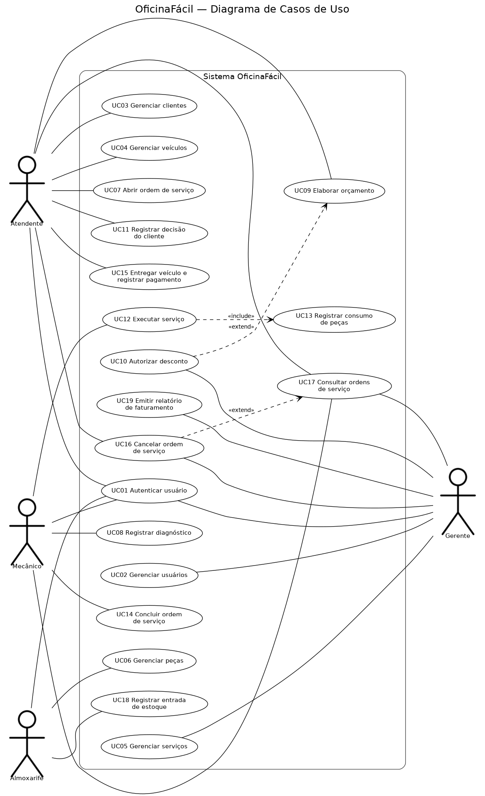

# OficinaFácil — Documento de Casos de Uso

**Disciplina:** Análise e Projeto de Sistemas · **Entrega:** Semana 1 · **Versão:** 1.0 (20/10/2026)

## 1. Visão geral do sistema

O **OficinaFácil** é um sistema desktop para oficinas mecânicas de pequeno e médio porte. Ele controla o ciclo completo de uma **ordem de serviço (OS)**: o atendente abre a OS para um veículo de um cliente; o mecânico registra o diagnóstico e executa o serviço; o atendente elabora o orçamento (serviços + peças − desconto) e registra a decisão do cliente; as peças usadas são baixadas do estoque mantido pelo almoxarife; e, ao final, o veículo é entregue com o registro do pagamento. O gerente administra usuários e o catálogo de serviços, autoriza descontos e acompanha o faturamento. O acesso é controlado por autenticação com perfis.

## 2. Atores

| Ator | Descrição |
|------|-----------|
| **Atendente** | Faz o contato com o cliente: cadastra clientes e veículos, abre a OS, elabora o orçamento, registra a aprovação ou recusa, cancela OS não iniciadas e entrega o veículo com o pagamento. |
| **Mecânico** | Executa o trabalho técnico: assume a OS, registra o diagnóstico, executa o serviço, informa as peças consumidas e conclui a OS. |
| **Almoxarife** | Responsável pelo estoque: cadastra peças e registra a entrada de mercadorias; acompanha peças abaixo do estoque mínimo. |
| **Gerente** | Administra a oficina: gerencia usuários e perfis, mantém o catálogo de serviços, autoriza descontos acima do limite, cancela OS em qualquer situação anterior à entrega e emite relatórios. |

Todos os atores se autenticam (UC01) antes de usar qualquer outra função.

## 3. Lista de casos de uso e rastreabilidade

| ID | Nome | Ator principal | Histórias de origem | Tipo |
|----|------|----------------|---------------------|------|
| UC01 | Autenticar usuário | Todos os atores | US01 | Negócio |
| UC02 | Gerenciar usuários | Gerente | US02 | CRUD |
| UC03 | Gerenciar clientes | Atendente | US03 | CRUD |
| UC04 | Gerenciar veículos | Atendente | US04 | CRUD |
| UC05 | Gerenciar serviços | Gerente | US08 | CRUD |
| UC06 | Gerenciar peças | Almoxarife | US09, US21 | CRUD |
| UC07 | Abrir ordem de serviço | Atendente | US05 | Negócio |
| UC08 | Registrar diagnóstico | Mecânico | US06, US07 | Negócio |
| UC09 | Elaborar orçamento | Atendente | US10, US17 | Negócio (cálculo) |
| UC10 | Autorizar desconto | Gerente | US17 | Negócio (validação) |
| UC11 | Registrar decisão do cliente | Atendente | US11 | Negócio |
| UC12 | Executar serviço | Mecânico | US12, US13 | Negócio |
| UC13 | Registrar consumo de peças | Mecânico | US13 | Negócio (validação) |
| UC14 | Concluir ordem de serviço | Mecânico | US14 | Negócio |
| UC15 | Entregar veículo e registrar pagamento | Atendente | US15 | Negócio |
| UC16 | Cancelar ordem de serviço | Atendente, Gerente | US18, US19 | Negócio |
| UC17 | Consultar ordens de serviço | Atendente, Mecânico, Gerente | US06, US16, US23 | Consulta |
| UC18 | Registrar entrada de estoque | Almoxarife | US20, US21 | Negócio |
| UC19 | Emitir relatório de faturamento | Gerente | US22 | Consulta |

Relações entre casos de uso (ver diagrama):

- **UC12 `<<include>>` UC13** — executar o serviço sempre envolve registrar as peças consumidas (a verificação e a baixa de estoque fazem parte do fluxo).
- **UC10 `<<extend>>` UC09** — a autorização do gerente só ocorre quando o desconto informado ultrapassa o limite (RN02).
- **UC16 `<<extend>>` UC17** — o cancelamento é uma opção oferecida a partir da consulta de uma OS.

Diagrama: [`diagramas/casos-de-uso.png`](diagramas/casos-de-uso.png) · fonte: [`diagramas/casos-de-uso.dot`](diagramas/casos-de-uso.dot)

## 4. Conformidade com os requisitos mínimos de complexidade

| Dimensão | Mínimo | OficinaFácil |
|----------|--------|--------------|
| Atores | 3 | 4 |
| Casos de uso | 12 | 19 |
| CRUD puro (máx. metade) | ≤ 9 | 5 (UC02 a UC06) |
| Classes de domínio | 9 | 11 previstas: Usuario, Cliente, Veiculo, Servico, Peca, OrdemServico, ItemServico, ItemPeca, Pagamento, MovimentoEstoque, HistoricoSituacao |
| Entidade com ciclo de vida (≥ 4 estados) | 1 | **OrdemServico**: ABERTA → DIAGNOSTICADA → AGUARDANDO_APROVACAO → APROVADA → EM_EXECUCAO → CONCLUIDA → ENTREGUE, mais CANCELADA (8 estados) |
| Regras com cálculo/validação | 2 | RN01, RN02, RN03, RN06, RN07 |
| Autenticação com perfis | Sim | UC01 + 4 perfis |

## 5. Regras de negócio

| ID | Regra |
|----|-------|
| RN01 | Total do orçamento = Σ(quantidade × preço do serviço) + Σ(quantidade × preço de venda da peça) − desconto. |
| RN02 | O atendente pode aplicar desconto de até 10% do subtotal. Acima disso, o orçamento só é concluído com a autorização de um gerente (UC10). |
| RN03 | A quantidade consumida de uma peça não pode exceder o estoque disponível; o estoque nunca fica negativo. |
| RN04 | A situação da OS só muda na sequência do ciclo de vida; cada mudança é registrada com data/hora e usuário. |
| RN05 | Senhas são armazenadas com hash; cada perfil acessa apenas os casos de uso do seu ator. |
| RN06 | Só uma OS CONCLUIDA pode ser entregue, e o pagamento registrado deve ser igual ao total do orçamento. |
| RN07 | CPF/CNPJ do cliente deve ser válido e único; a placa do veículo deve ser única e no formato válido. |

## 6. Especificação dos casos de uso

Modelo: livro didático (identificação, atores, pré/pós-condições, fluxos principal, alternativos e de exceção, regras e origem). Convenção: **A:** ação do ator · **S:** resposta do sistema.

---

### UC01 — Autenticar usuário

- **Ator principal:** Atendente, Mecânico, Almoxarife, Gerente
- **Resumo:** O usuário informa suas credenciais para acessar as funções do seu perfil.
- **Pré-condição:** O usuário está cadastrado e ativo (UC02).
- **Pós-condição:** Sessão iniciada com o perfil do usuário; menu exibe apenas as funções permitidas.
- **Fluxo principal**
  1. S: Exibe a tela de login.
  2. A: Informa login e senha e confirma.
  3. S: Valida as credenciais (RN05).
  4. S: Abre a tela inicial com as funções do perfil.
- **Fluxos de exceção**
  - 3a. Credenciais inválidas: S informa o erro e retorna ao passo 1.
  - 3b. Usuário inativo: S informa que o acesso está bloqueado e retorna ao passo 1.
- **Regras:** RN05 · **Origem:** US01

### UC02 — Gerenciar usuários

- **Ator principal:** Gerente
- **Resumo:** Cadastrar, consultar, alterar e inativar usuários e definir seus perfis.
- **Pré-condição:** Gerente autenticado.
- **Pós-condição:** Cadastro de usuários atualizado.
- **Fluxo principal**
  1. S: Lista os usuários com seus perfis.
  2. A: Escolhe *Novo usuário*.
  3. S: Exibe o formulário (nome, login, senha, perfil).
  4. A: Preenche e confirma.
  5. S: Valida (login único, senha mínima), grava a senha com hash e atualiza a lista.
- **Fluxos alternativos**
  - 2a. Alterar ou inativar: A seleciona um usuário e escolhe *Editar* ou *Inativar*; S aplica a alteração.
- **Fluxos de exceção**
  - 5a. Login já existente: S informa e mantém o formulário aberto.
  - 2b. Tentativa de inativar o único gerente ativo: S impede a operação.
- **Regras:** RN05 · **Origem:** US02

### UC03 — Gerenciar clientes

- **Ator principal:** Atendente
- **Resumo:** Cadastrar, consultar, alterar e excluir clientes (pessoa física ou jurídica).
- **Pré-condição:** Atendente autenticado.
- **Pós-condição:** Cadastro de clientes atualizado.
- **Fluxo principal**
  1. S: Lista os clientes e oferece busca por nome ou CPF/CNPJ.
  2. A: Escolhe *Novo cliente*.
  3. S: Exibe o formulário (nome, CPF/CNPJ, telefone, e-mail, endereço).
  4. A: Preenche e confirma.
  5. S: Valida (RN07), grava e atualiza a lista.
- **Fluxos alternativos**
  - 2a. Editar: A seleciona o cliente e altera os dados.
- **Fluxos de exceção**
  - 5a. CPF/CNPJ inválido ou duplicado: S informa e mantém o formulário.
  - 2b. Excluir cliente com veículos ou OS vinculados: S impede a exclusão e sugere inativar.
- **Regras:** RN07 · **Origem:** US03

### UC04 — Gerenciar veículos

- **Ator principal:** Atendente
- **Resumo:** Cadastrar, consultar, alterar e excluir veículos vinculados a um cliente.
- **Pré-condição:** Atendente autenticado; cliente cadastrado (UC03).
- **Pós-condição:** Veículo vinculado ao cliente.
- **Fluxo principal**
  1. A: Seleciona um cliente e escolhe *Veículos*.
  2. S: Lista os veículos do cliente.
  3. A: Escolhe *Novo veículo*.
  4. S: Exibe o formulário (placa, marca, modelo, ano, cor).
  5. A: Preenche e confirma.
  6. S: Valida (RN07), grava e atualiza a lista.
- **Fluxos de exceção**
  - 6a. Placa inválida ou já cadastrada: S informa e mantém o formulário.
  - 3a. Excluir veículo com OS vinculada: S impede a exclusão.
- **Regras:** RN07 · **Origem:** US04

### UC05 — Gerenciar serviços

- **Ator principal:** Gerente
- **Resumo:** Manter o catálogo de serviços oferecidos, com o preço da mão de obra.
- **Pré-condição:** Gerente autenticado.
- **Pós-condição:** Catálogo atualizado.
- **Fluxo principal**
  1. S: Lista os serviços do catálogo.
  2. A: Escolhe *Novo serviço*.
  3. S: Exibe o formulário (descrição, preço, tempo estimado).
  4. A: Preenche e confirma.
  5. S: Valida (preço > 0, descrição única), grava e atualiza a lista.
- **Fluxos alternativos**
  - 2a. Editar preço ou inativar serviço: S aplica; orçamentos já elaborados mantêm o preço da época.
- **Fluxos de exceção**
  - 5a. Dados inválidos: S informa e mantém o formulário.
- **Origem:** US08

### UC06 — Gerenciar peças

- **Ator principal:** Almoxarife
- **Resumo:** Cadastrar e manter as peças, com preço de venda, estoque atual e estoque mínimo.
- **Pré-condição:** Almoxarife autenticado.
- **Pós-condição:** Cadastro de peças atualizado.
- **Fluxo principal**
  1. S: Lista as peças, destacando as abaixo do estoque mínimo.
  2. A: Escolhe *Nova peça*.
  3. S: Exibe o formulário (código, descrição, preço de venda, estoque inicial, estoque mínimo).
  4. A: Preenche e confirma.
  5. S: Valida (código único, valores ≥ 0), grava e atualiza a lista.
- **Fluxos alternativos**
  - 2a. Editar ou inativar peça: S aplica a alteração (o estoque só muda por UC13 e UC18).
- **Fluxos de exceção**
  - 5a. Código duplicado ou valor inválido: S informa e mantém o formulário.
- **Origem:** US09, US21

### UC07 — Abrir ordem de serviço

- **Ator principal:** Atendente
- **Resumo:** Registrar a entrada de um veículo na oficina com a queixa do cliente.
- **Pré-condição:** Atendente autenticado; cliente e veículo cadastrados (UC03, UC04).
- **Pós-condição:** OS criada na situação **ABERTA**, com número, data de entrada e histórico inicial (RN04).
- **Fluxo principal**
  1. A: Escolhe *Nova ordem de serviço*.
  2. S: Solicita a seleção do cliente.
  3. A: Seleciona o cliente.
  4. S: Lista os veículos do cliente.
  5. A: Seleciona o veículo e informa a queixa e a quilometragem.
  6. S: Cria a OS (ABERTA), gera o número e exibe o comprovante de entrada.
- **Fluxos alternativos**
  - 3a. Cliente ou veículo não cadastrado: A aciona UC03 ou UC04 e retorna ao passo 3.
- **Fluxos de exceção**
  - 6a. Veículo já possui OS em andamento: S informa a OS existente e não cria outra.
- **Regras:** RN04 · **Origem:** US05

### UC08 — Registrar diagnóstico

- **Ator principal:** Mecânico
- **Resumo:** O mecânico assume a OS, avalia o veículo e registra o diagnóstico técnico.
- **Pré-condição:** Mecânico autenticado; OS na situação ABERTA.
- **Pós-condição:** OS atribuída ao mecânico, com diagnóstico registrado, na situação **DIAGNOSTICADA**.
- **Fluxo principal**
  1. S: Lista as OS abertas (UC17).
  2. A: Seleciona uma OS e escolhe *Assumir*.
  3. S: Atribui a OS ao mecânico.
  4. A: Registra o diagnóstico e os serviços recomendados do catálogo.
  5. S: Grava e altera a situação para DIAGNOSTICADA (RN04).
- **Fluxos de exceção**
  - 2a. OS já assumida por outro mecânico: S informa e retorna ao passo 1.
  - 4a. Diagnóstico vazio: S exige o preenchimento.
- **Regras:** RN04 · **Origem:** US06, US07

### UC09 — Elaborar orçamento

- **Ator principal:** Atendente
- **Resumo:** Montar o orçamento da OS com serviços e peças e calcular o total.
- **Pré-condição:** Atendente autenticado; OS na situação DIAGNOSTICADA.
- **Pós-condição:** Orçamento gravado com total calculado; OS na situação **AGUARDANDO_APROVACAO**.
- **Fluxo principal**
  1. A: Abre a OS diagnosticada e escolhe *Elaborar orçamento*.
  2. S: Exibe os serviços recomendados no diagnóstico.
  3. A: Ajusta os serviços e inclui peças com as quantidades.
  4. S: Calcula o subtotal e o total a cada alteração (RN01).
  5. A: (Opcional) informa um desconto.
  6. A: Confirma o orçamento.
  7. S: Grava, altera a situação para AGUARDANDO_APROVACAO e exibe o orçamento para apresentar ao cliente.
- **Fluxos alternativos (extensão)**
  - 5a. Desconto acima de 10% do subtotal (RN02): S aciona **UC10 — Autorizar desconto**; com a autorização, retorna ao passo 6.
- **Fluxos de exceção**
  - 3a. Peça sem estoque suficiente: S alerta (informativo; a baixa ocorre em UC13).
  - 6a. Orçamento sem nenhum item: S exige ao menos um serviço.
- **Regras:** RN01, RN02, RN04 · **Origem:** US10, US17

### UC10 — Autorizar desconto *(extensão de UC09)*

- **Ator principal:** Gerente
- **Resumo:** O gerente aprova ou nega um desconto acima do limite do atendente.
- **Pré-condição:** Desconto informado em UC09 superior a 10% do subtotal.
- **Pós-condição:** Desconto autorizado (com registro do gerente) ou negado.
- **Fluxo principal**
  1. S: Solicita a autenticação de um gerente (login e senha).
  2. A: Informa as credenciais.
  3. S: Valida o perfil de gerente (RN05) e exibe o desconto solicitado e o total resultante.
  4. A: Autoriza o desconto.
  5. S: Registra a autorização (gerente, data/hora, valor) e retorna a UC09.
- **Fluxos alternativos**
  - 4a. Gerente nega: S descarta o desconto e retorna a UC09 sem desconto.
- **Fluxos de exceção**
  - 3a. Usuário sem perfil de gerente: S recusa a autorização.
- **Regras:** RN02, RN05 · **Origem:** US17

### UC11 — Registrar decisão do cliente

- **Ator principal:** Atendente
- **Resumo:** Registrar se o cliente aprovou ou recusou o orçamento.
- **Pré-condição:** OS na situação AGUARDANDO_APROVACAO.
- **Pós-condição:** OS **APROVADA** ou **CANCELADA** (recusa), com data e observações.
- **Fluxo principal**
  1. A: Abre a OS e escolhe *Registrar decisão*.
  2. S: Exibe o orçamento.
  3. A: Informa *Aprovado* e confirma.
  4. S: Altera a situação para APROVADA e registra data/hora (RN04).
- **Fluxos alternativos**
  - 3a. Cliente recusa: A informa *Recusado* e o motivo; S altera a situação para CANCELADA.
  - 3b. Cliente pede revisão: A retorna ao orçamento (UC09), mantendo AGUARDANDO_APROVACAO.
- **Regras:** RN04 · **Origem:** US11

### UC12 — Executar serviço

- **Ator principal:** Mecânico
- **Resumo:** O mecânico inicia e acompanha a execução dos serviços aprovados.
- **Pré-condição:** OS na situação APROVADA, atribuída ao mecânico.
- **Pós-condição:** OS na situação **EM_EXECUCAO**, com andamento e peças consumidas registrados.
- **Fluxo principal**
  1. A: Abre a OS aprovada e escolhe *Iniciar execução*.
  2. S: Altera a situação para EM_EXECUCAO e registra o início (RN04).
  3. A: Marca os serviços realizados e registra observações.
  4. S: Aciona **UC13 — Registrar consumo de peças** *(include)*.
  5. S: Atualiza o andamento da OS.
- **Fluxos alternativos**
  - 3a. Serviço adicional necessário: A informa; o atendente deve refazer o orçamento (UC09) e obter nova aprovação (UC11).
- **Regras:** RN04 · **Origem:** US12, US13

### UC13 — Registrar consumo de peças *(incluído em UC12)*

- **Ator principal:** Mecânico
- **Resumo:** Registrar as peças utilizadas e baixá-las do estoque.
- **Pré-condição:** OS EM_EXECUCAO.
- **Pós-condição:** Itens de peça vinculados à OS; estoque abatido com um movimento de saída registrado.
- **Fluxo principal**
  1. A: Seleciona a peça e informa a quantidade usada.
  2. S: Verifica o estoque disponível (RN03).
  3. S: Baixa o estoque, registra o movimento de saída e inclui o item na OS.
  4. S: Alerta se o saldo ficou abaixo do estoque mínimo.
- **Fluxos de exceção**
  - 2a. Quantidade maior que o estoque: S recusa e informa o saldo; A corrige a quantidade ou solicita reposição ao almoxarife (UC18).
- **Regras:** RN03 · **Origem:** US13

### UC14 — Concluir ordem de serviço

- **Ator principal:** Mecânico
- **Resumo:** Encerrar a parte técnica e sinalizar que o veículo está pronto.
- **Pré-condição:** OS EM_EXECUCAO.
- **Pós-condição:** OS **CONCLUIDA**, com data de conclusão.
- **Fluxo principal**
  1. A: Abre a OS e escolhe *Concluir*.
  2. S: Exibe o resumo (serviços feitos, peças consumidas, total).
  3. A: Confirma a conclusão.
  4. S: Altera a situação para CONCLUIDA e registra data/hora (RN04).
- **Fluxos de exceção**
  - 2a. Há serviço do orçamento sem execução registrada: S exige marcar como realizado ou justificar.
- **Regras:** RN04 · **Origem:** US14

### UC15 — Entregar veículo e registrar pagamento

- **Ator principal:** Atendente
- **Resumo:** Receber o pagamento do cliente e entregar o veículo.
- **Pré-condição:** OS na situação CONCLUIDA.
- **Pós-condição:** Pagamento registrado; OS **ENTREGUE** (situação final).
- **Fluxo principal**
  1. A: Abre a OS concluída e escolhe *Entregar*.
  2. S: Exibe o total final.
  3. A: Informa a forma de pagamento (dinheiro, cartão ou PIX) e confirma o valor recebido.
  4. S: Valida o valor (RN06), registra o pagamento e altera a situação para ENTREGUE (RN04).
  5. S: Emite o comprovante de entrega.
- **Fluxos de exceção**
  - 4a. Valor diferente do total: S recusa e informa a diferença.
- **Regras:** RN04, RN06 · **Origem:** US15

### UC16 — Cancelar ordem de serviço *(extensão de UC17)*

- **Ator principal:** Atendente (OS ainda não iniciada) · Gerente (qualquer situação anterior à entrega)
- **Resumo:** Cancelar uma OS registrando o motivo.
- **Pré-condição:** OS não ENTREGUE e não CANCELADA. Atendente: apenas ABERTA, DIAGNOSTICADA ou AGUARDANDO_APROVACAO.
- **Pós-condição:** OS **CANCELADA**; peças já consumidas permanecem registradas.
- **Fluxo principal**
  1. A: Na consulta da OS (UC17), escolhe *Cancelar*.
  2. S: Solicita o motivo.
  3. A: Informa o motivo e confirma.
  4. S: Altera a situação para CANCELADA e registra no histórico (RN04).
- **Fluxos de exceção**
  - 1a. Atendente tenta cancelar OS APROVADA ou além: S informa que é necessário um gerente.
  - 3a. Motivo vazio: S exige o preenchimento.
- **Regras:** RN04, RN05 · **Origem:** US18, US19

### UC17 — Consultar ordens de serviço

- **Ator principal:** Atendente, Mecânico, Gerente
- **Resumo:** Buscar e visualizar OS e seu histórico de situações.
- **Pré-condição:** Usuário autenticado.
- **Pós-condição:** Nenhuma alteração de dados.
- **Fluxo principal**
  1. A: Informa filtros (placa, cliente, situação, período).
  2. S: Lista as OS que atendem aos filtros (mecânico vê as abertas e as suas; atendente e gerente veem todas).
  3. A: Seleciona uma OS.
  4. S: Exibe os dados, o orçamento, as peças e o histórico de situações.
- **Fluxos alternativos**
  - 4a. A partir da OS, o usuário pode acionar UC16 (*extend*), respeitando as permissões do seu perfil.
- **Fluxos de exceção**
  - 2a. Nenhum resultado: S informa que não há OS para os filtros.
- **Origem:** US06, US16, US23

### UC18 — Registrar entrada de estoque

- **Ator principal:** Almoxarife
- **Resumo:** Registrar a chegada de peças e atualizar o estoque.
- **Pré-condição:** Almoxarife autenticado; peça cadastrada (UC06).
- **Pós-condição:** Estoque acrescido; movimento de entrada registrado.
- **Fluxo principal**
  1. S: Lista as peças abaixo do estoque mínimo em destaque.
  2. A: Seleciona a peça e informa quantidade, custo unitário e documento de origem.
  3. S: Valida (quantidade > 0), soma ao estoque e registra o movimento de entrada.
- **Fluxos de exceção**
  - 3a. Quantidade inválida: S informa e mantém o formulário.
- **Origem:** US20, US21

### UC19 — Emitir relatório de faturamento

- **Ator principal:** Gerente
- **Resumo:** Totalizar o faturamento de um período.
- **Pré-condição:** Gerente autenticado.
- **Pós-condição:** Nenhuma alteração de dados.
- **Fluxo principal**
  1. A: Informa o período.
  2. S: Considera as OS ENTREGUES no período e calcula: total faturado, descontos concedidos, quantidade de OS e valor por serviço e por peça.
  3. S: Exibe o relatório.
- **Fluxos alternativos**
  - 3a. A pede para exportar; S gera o arquivo (formato a definir em entrega futura).
- **Fluxos de exceção**
  - 1a. Período inválido (início posterior ao fim): S informa o erro.
  - 2a. Nenhuma OS no período: S exibe o relatório zerado.
- **Regras:** RN01, RN06 · **Origem:** US22
